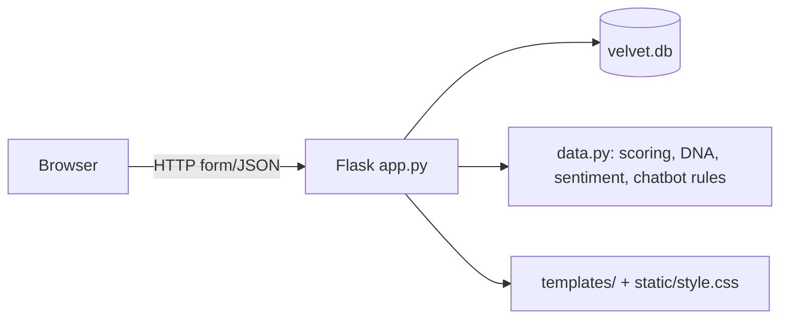

# ARCHITECTURE — Velvet Bloom

## 1. Stack (simplest maintainable choice)
- Frontend: server-rendered HTML/CSS, Jinja2 templates, no JS framework, no build step.
  Reason: runs on a slow PC, no npm, no bundler.
- Backend: Python 3.12 + Flask 3.1.3 (only dependency, see requirements.txt).
- Database: SQLite file velvet.db (created by app.init_db on first run).
- Auth: Flask session cookie + werkzeug password hashing; roles in the users table.
- Hosting/deployment: local only (127.0.0.1:5000). NOT deployed; no live URL is claimed.

## 2. Component diagram (Mermaid)

## 3. Folder structure
- app.py — all routes, auth guards, checkout, chatbot wiring (single file, deliberate:
  keeps the project small enough for a viva walkthrough).
- data.py — sample perfumes, scoring, DNA similarity, sentiment, note helpers.
- templates/ (18 files) — one per page, all extending base.html.
- static/style.css — the whole design system. tests/test_app.py — real checks.
- requirements.txt (Flask only), run.sh (venv + run), velvet.db (generated, gitignored).

## 4. Boundaries
UI: templates only. Business logic: data.py scoring/DNA/sentiment. Data access: app.py
SQLite queries. Validation: server-side in app.py (types, login, admin role, stock).
No business rule lives only in the browser.

## 5. Data flow (example: finder)
Browser form -> POST /finder -> data.score_perfume per perfume -> ranked list + reasons
-> finder.html. Chatbot: POST /api/chat -> keyword/budget extraction -> ranked/catalog
lookup -> JSON answer. Checkout: cart (session ids) -> DB prices re-read -> order +
order_items + stock decrement in one transaction -> orders page.

## 6. Auth, sessions, secrets
Session cookie is HttpOnly; secret key from VELVET_SECRET_KEY env var if set,
otherwise a fresh random secret per process (5-team fix, Oct 2026 — no hardcoded
fallback exists anymore, see AUTH.md). No secrets in code, templates
or frontend JS. No API keys at all in the MVP (no LLM).

## 7. Conventions
API: JSON only for /api/chat and /api/recommend; everything else is HTML forms.
DB: SQLite, one file, created_at timestamps on orders/chat. Migrations: none needed —
init_db uses CREATE TABLE IF NOT EXISTS and seeds only when empty.

## 8. Performance, reliability, observability
Server-rendered pages, no external calls, no images to download. Backup = copy velvet.db.
Logging: Flask dev output only; no user passwords are ever logged.

## 9. Dependencies
Flask + its bundled Werkzeug/Jinja2 only. Deliberately no ORM, no paid service, no LLM SDK.

## 10. Risks, alternatives, change criteria
- SQLite is fine for a demo; if real concurrent users appear, move to PostgreSQL/MySQL
  and add migrations — that is a future change, not this MVP.
- Single-file app.py will need splitting if the feature count grows well beyond this MVP.
- Conflict check: none with PRD.md/DESIGN.md; the design tokens match static/style.css.
