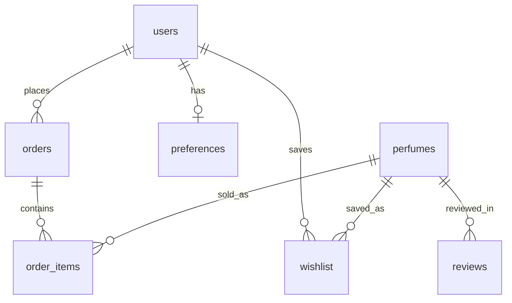

# DATABASE — Velvet Bloom

## 1. Tables (SQLite, file velvet.db)
- users(id, name, email UNIQUE, password_hash, role='customer'|'admin')
- perfumes(id, name, category, fragrance, occasions CSV, seasons CSV, strength,
  price INTEGER PKR, stock INTEGER, top, middle, base, description)
- wishlist(user_id, perfume_id, UNIQUE pair)
- orders(id, user_id, total INTEGER, status, address, created_at)
- order_items(order_id, perfume_id, qty, price INTEGER at purchase)
- preferences(user_id PK, fragrance, occasion, budget_min, budget_max, strength,
  season, personality)
- reviews(id, perfume_id, text, rating, sentiment)
- chat_history(id, user_id NULL, question, answer, created_at)

## 2. Keys, relationships, rules
- perfumes.id referenced by wishlist/order_items/reviews (no FK enforcement in code;
  deletes of a perfume do not cascade — a known limitation, see §9).
- users.email UNIQUE; wishlist pair UNIQUE; preferences one row per user (upsert).
- Stock is decremented only inside the checkout transaction; checkout aborts (rollback)
  if any item lacks stock.

## 3. ER diagram (Mermaid)

## 4. Timestamps / audit
orders.created_at and chat_history.created_at use CURRENT_TIMESTAMP. No other audit
fields are genuinely needed for a demo; admin edits are not audit-logged (limitation).

## 5. Validation and integrity
Prices and stock are INTEGER, validated server-side (int() conversion, error flash on
bad input). Empty name/email/password are rejected. Duplicate emails rejected by the
UNIQUE constraint. Frontend filters never substitute for DB checks.

## 6. Privacy and retention
Minimum data only (see PRD §11). No payment data is stored at all. Demo data can be
deleted by deleting velvet.db and re-running the app (it re-seeds).

## 7. Access control (DB level is NOT the guard — app level is)
SQLite has no row-level security; all access control is enforced in app.py
(login_required / admin_required decorators + user_id filtering on orders/wishlist/
profile). Never rely on a hidden URL or a frontend filter.

## 8. Migrations, seed, backup
No migration tool: init_db() creates tables if missing and seeds 14 sample perfumes,
8 sample reviews and the demo admin only when the tables are empty. Backup: copy
velvet.db. Never run destructive SQL against a real database — there is none here.

## 9. Indexes / performance and limitations
No custom indexes: catalog size is 14 rows, so full scans are fine. Known limitations:
no FK cascade, no audit log for admin edits, no soft delete. These are acceptable for
the demo and listed as must-fix items if the site ever goes beyond demo use.

## 10. Traceability
users->FR-003, perfumes->FR-001/002/012, wishlist->FR-005, orders/order_items->FR-004/006,
preferences->FR-010, reviews->FR-013, chat_history->FR-011.
